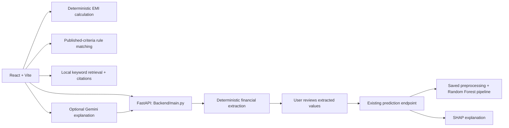

# TrustLoan AI

TrustLoan AI is an educational prototype for loan eligibility modeling. Its primary application is a React/Vite frontend backed by one FastAPI service; the older Streamlit prototype remains in `Backend/app.py`. The production-style API entry point is `Backend/main.py`.

## Architecture



### Responsibilities

- **AIML:** the saved scikit-learn Random Forest pipeline predicts the model class and approval-class probability. The trained model was not retrained or replaced.
- **XAI:** SHAP contributions come from the existing explainer/artifacts and describe model contribution, not causation.
- **NLP:** deterministic parsing extracts explicitly stated amounts, income periods, tenure, CIBIL score, dependents, education, employment and supported asset fields. Extracted data is shown for user confirmation before the existing prediction form is submitted.
- **GenAI:** the optional server-side Gemini advisor explains supplied prediction and SHAP evidence. It does not decide eligibility. It uses a 10-second provider timeout and reports a clear offline state when unconfigured or unavailable.
- **Lender matching:** deterministic rules compare only published criteria in the local personal-loan catalogue. Unknown criteria remain unknown; no approval probability or match percentage is produced.
- **Retrieval:** `/api/knowledge/search` uses lightweight keyword retrieval over locally curated source passages and returns the source URL and verification date. An explicit “Ask optional AI” action can pass those passages to Gemini for a cited answer; offline results remain visible without an API key. It does not scrape live sites or use a paid vector database.
- **EMI:** a deterministic amortization formula calculates the installment; the entered rate is illustrative, not a lender quote.

The existing model expects exactly these eleven inputs, in its saved pipeline schema:

`no_of_dependents`, `education`, `self_employed`, `income_annum`, `loan_amount`, `loan_term`, `cibil_score`, `residential_assets_value`, `commercial_assets_value`, `luxury_assets_value`, and `bank_asset_value`.

`loan_id` is not a model input. The saved pipeline performs its original preprocessing. `loan_term` is expressed in years. The model's reported 98.13% held-out accuracy is dataset-specific and is not a real-world banking accuracy guarantee.

## Local development

### Backend

From the repository root in PowerShell:

```powershell
python -m pip install -r Backend/requirements.txt
Set-Location Backend
python -m uvicorn main:app --reload --port 8000
```

The model files are loaded from the repository's existing `models/v2/` directory. Do not copy or retrain these artifacts as part of routine startup.

### Frontend

```powershell
Set-Location Frontend
npm install
npm run dev
```

The frontend defaults to `https://trustloan-ai.onrender.com`. For local development, set `VITE_API_BASE_URL=http://127.0.0.1:8000` in `Frontend/.env.local`.

### Environment variables

| Variable | Required | Purpose |
|---|---:|---|
| `GEMINI_API_KEY` | No | Optional server-side key for personalized GenAI explanations. Never expose it in frontend variables. |
| `GEMINI_MODEL` | No | Gemini model name; defaults to `gemini-3-flash-preview`. |
| `FRONTEND_ORIGINS` | No | Comma-separated additional browser origins allowed by CORS, e.g. `https://trustloan-ai.vercel.app,http://localhost:5173`. Existing local and deployed origins remain allowed. |
| `FRONTEND_ORIGIN` | No | Legacy single-origin CORS setting; retained for backward compatibility. |
| `VITE_API_BASE_URL` | No | Frontend build-time API base URL; defaults to the deployed Render API URL. |

Copy `.env.example` for local backend configuration and `Frontend/.env.example` for frontend configuration. Do not commit populated secret files. The backend accepts request bodies up to 64 KiB and bounds free-text fields separately. It does not log conversation text or complete financial profiles.

## API

| Method | Path | Purpose |
|---|---|---|
| `GET` | `/` | Service identity and status |
| `GET` | `/health` | Health check |
| `POST` | `/api/predict` | Backward-compatible Random Forest prediction and SHAP contribution response |
| `POST` | `/api/nlp/extract` | Deterministic field extraction, confidence metadata, ambiguity and validation feedback |
| `POST` | `/api/assistant/chat` | Intent detection and ephemeral one-question-at-a-time input collection |
| `GET` | `/api/lenders` | Personal-loan catalogue and its source-backed criteria |
| `POST` | `/api/lenders/match` | Deterministic comparison of provided values to published criteria |
| `POST` | `/api/emi/calculate` | EMI, total interest and total payment |
| `GET` | `/api/knowledge/search?query=...` | Local retrieval with citations and freshness metadata |
| `POST` | `/api/knowledge/answer` | Optional Gemini answer grounded in retrieved passages; citations remain in the response |
| `POST` | `/api/advisor` | Optional Gemini explanation of supplied prediction and SHAP evidence |
| `GET` | `/api/insights` | Existing saved model metrics |
| `POST` | `/api/shap` | Existing SHAP endpoint |
| `POST` | `/api/whatif` | Existing two-profile model comparison |
| `POST` | `/api/report` | Existing PDF report |

The assistant intents are `CHECK_ELIGIBILITY`, `EXPLAIN_PREDICTION`, `FIND_LENDERS`, `CALCULATE_EMI`, `ASK_DOCUMENTS`, `ASK_CIBIL`, `ASK_LOAN_PROCESS`, and `COMPARE_LENDERS`. Conversation content is held in the current frontend session and is not persisted by the API.

## Lender source policy

The catalogue is restricted to personal loans and was checked against official product pages on 27 October 2026:

- [HDFC Bank Personal Loan](https://www.hdfc.bank.in/personal-loan) lists an amount range of ₹25,000–₹1 crore and a calculator tenure range of 1–7 years. Its page also states terms apply and disbursal is at the bank's discretion. Age, minimum income, and credit-score thresholds are not established by the reviewed page and remain unknown.
- [SBI Personal Loan](https://sbi.bank.in/web/personal-banking/loans/personal-loans/sbi-personal-loan) describes the product as for salaried employees with an SBI salary account. The reviewed page did not establish the amount, tenure, age, income, or credit-score criteria; these remain unknown.

Only verified official product and application URLs are exposed. These sources can change; their verification date is displayed with results. “Published criteria appear compatible” is not approval. A lender independently determines final eligibility and approval. Do not infer eligibility rules from another loan category or treat an unreported criterion as a match.

## Testing

```powershell
Set-Location Backend
python -m pytest -q
Set-Location ../Frontend
npm run build
```

The backend tests cover model and SHAP regression, extraction and validation, EMI, lender rules and unknowns, local retrieval, assistant fallback, and API response shapes. The frontend currently has a production build command but no separate automated test script.

## Deployment

### Render API

Use the repository's `Backend` directory as the Render service root, install with `pip install -r requirements.txt`, and start with:

```text
uvicorn main:app --host 0.0.0.0 --port $PORT
```

Set `FRONTEND_ORIGINS` to the deployed frontend origin(s). Set `GEMINI_API_KEY` and optionally `GEMINI_MODEL` only if GenAI explanations are desired. Keep the existing repository `models/v2/` artifacts available to the backend deployment. Verify `GET /health` after deploy.

### Frontend deployment

Set the frontend build variable `VITE_API_BASE_URL` to the deployed API origin, e.g. `https://trustloan-ai.onrender.com`. Add that frontend origin to `FRONTEND_ORIGINS` on the API. Do not place Gemini credentials in frontend build variables.

## Responsible-use limits

- TrustLoan is an academic educational prototype, not a lender, credit bureau, official approval, or bank partnership.
- No bank login credentials, passwords, card PINs, or OTPs should be entered. The application does not submit loan applications.
- The model learns from a public dataset. Its output and probability are not guarantees, and its SHAP results are not causal explanations.
- A GenAI explanation can be unavailable; prediction, SHAP, EMI, lender matching, and local retrieval do not depend on GenAI.
- Lender information is partial and can become stale. Always follow the official lender page and contact the lender for a current decision.
